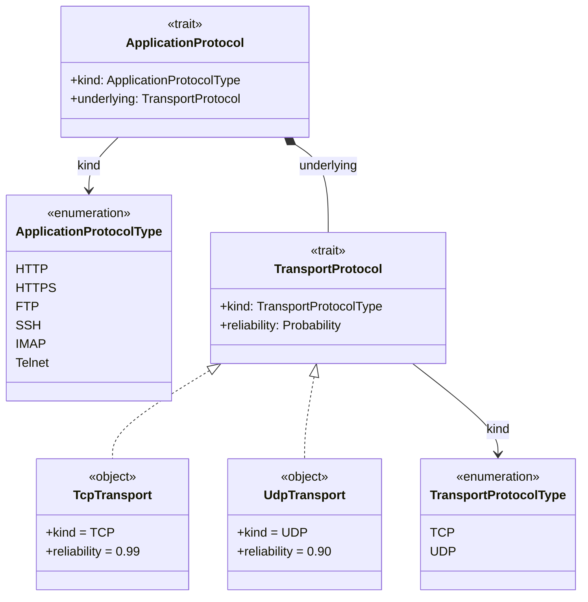
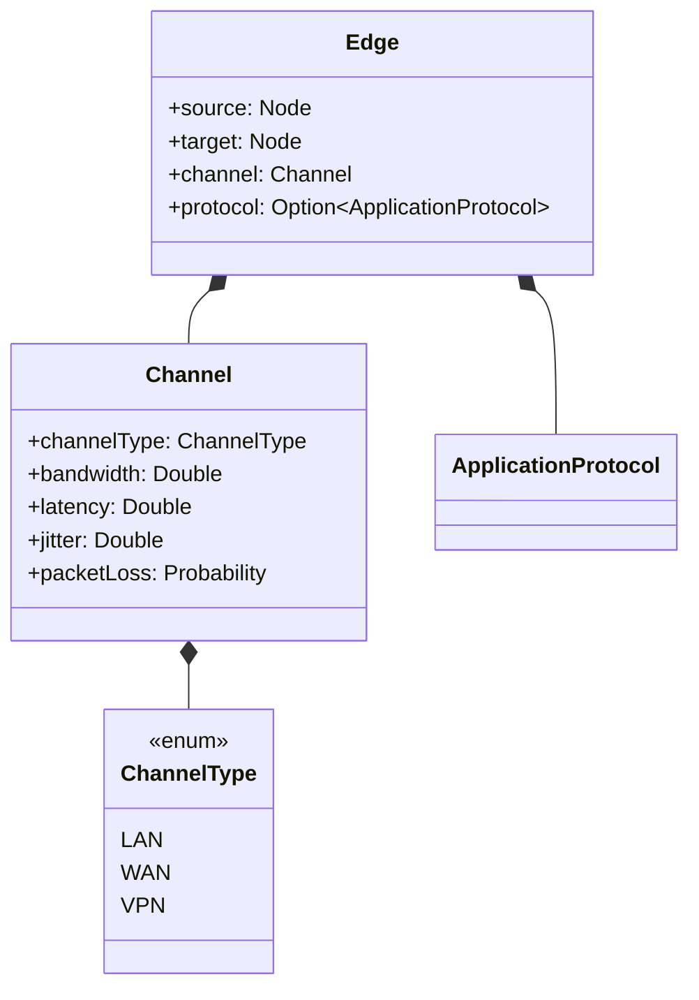
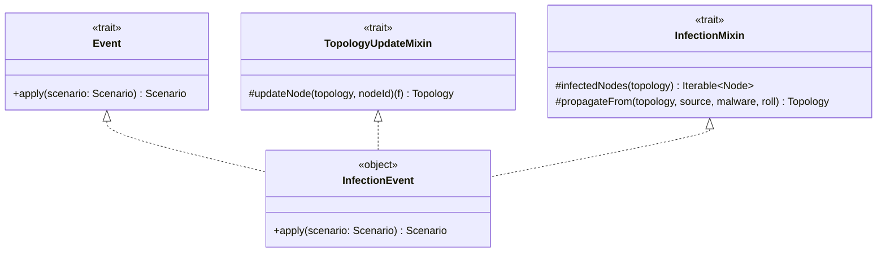
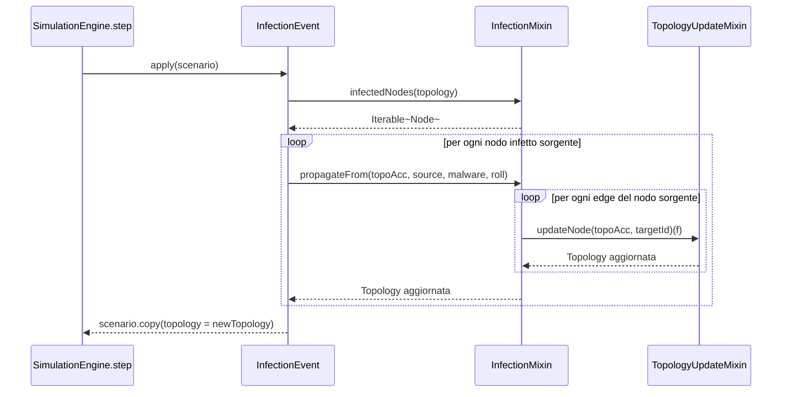
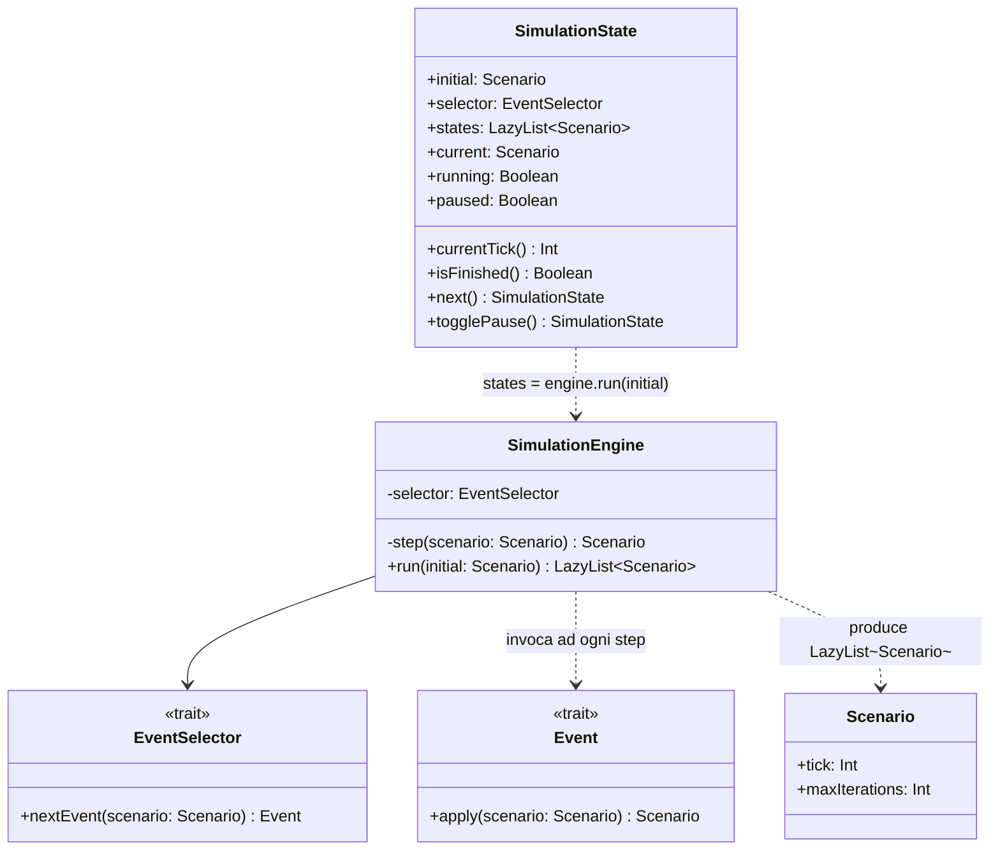
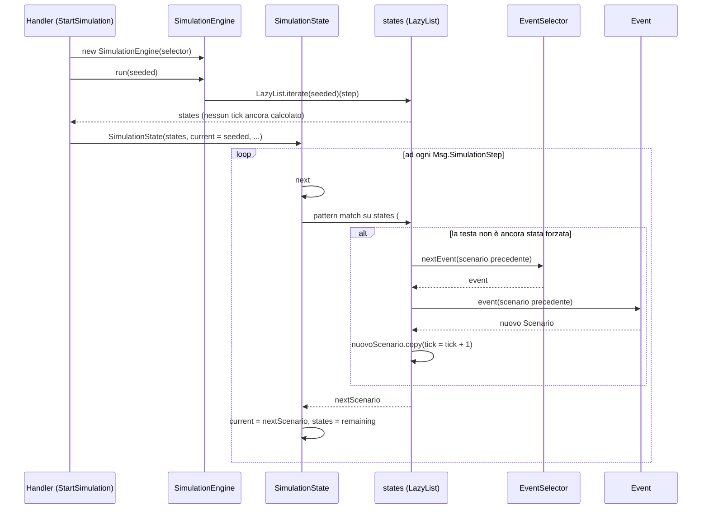

# Implementazione — Visconti Aldo

Le aree di cui sono responsabile principale sono: il modello dei protocolli e dei canali
di rete, gli eventi di simulazione come trait componibili a mixin, e il motore di
simulazione (il ciclo tick-based e la sua esposizione come stato avanzabile un passo alla
volta).

---

## Protocolli

Vista la scelta di seguire un approccio modulare ed estendibile, la gerarchia di classi e trait è stata progettata per consentire l'aggiunta di nuovi protocolli senza modificare il codice esistente.
L'architettura separa chiaramente il livello Applicativo (Application Layer) da quello di Trasporto (Transport Layer), seguendo il principio di "Composition over Inheritance". 
Questo approccio offre diversi vantaggi, tra cui:
- `Flessibilità`: riproduce fedelmente il modello ISO/OSI e la pila TCP/IP, permettendo a un protocollo applicativo di definire o cambiare il proprio protocollo sottostante senza modificare la propria logica interna.

L'uso di `<<trait>>` per TransportProtocol e ApplicationProtocol offre un'interfaccia chiara ed essenziale, ciò produce conseguentemente un codice più leggibile e manutenibile, riducendo la complessità e migliorando la comprensione del sistema, garantendoci i seguenti vantaggi:

- **Un contratto comune** : qualsiasi protocollo di trasporto deve esporre un tipo (kind) e una metrica di affidabilità (reliability).

- **Estensibilità (Open/Closed Principle)** : È possibile aggiungere nuovi protocolli di trasporto (es. SCTP o QUIC) creando un nuovo oggetto che implementa TransportProtocol, senza dover modificare ApplicationProtocol o il resto del sistema.

```scala
enum TransportProtocolType:
  case TCP, UDP

trait TransportProtocol:
  def kind: TransportProtocolType
  def reliability: Probability

case object TcpTransport extends TransportProtocol:
  val kind: TransportProtocolType = TransportProtocolType.TCP
  val reliability: Probability = Probability.apply(0.99).toOption.get

case object UdpTransport extends TransportProtocol:
  val kind: TransportProtocolType = TransportProtocolType.UDP
  val reliability: Probability = Probability.apply(0.90).toOption.get
```


## Canali di rete
Dopo aver definito i protocolli, è stato necessario modellare i canali di rete, che rappresentano le connessioni tra i nodi della topologia.



La classe Channel accentra e modella in modo coerente tutte le metriche fondamentali che caratterizzano la qualità di un canale di comunicazione (Quality of Service - QoS),
raggruppa proprietà fisiche e dinamiche interdipendenti (bandwidth, latency, jitter, packetLoss).
Invece di usare generici numeri reali, l'uso del tipo `Probability` garantisce la validazione dei valori nel range $[0, 1]$ per la perdita di pacchetti.

Vista la necessità di avere valori di default per i canali, sono stati implementati due metodi `default` all'interno del companion object, che permettono di ottenere un canale con valori predefiniti per un determinato tipo di canale, oppure di creare un canale con valori personalizzati, mantenendo comunque la validazione dei valori.


```scala

  case class Channel(
      channelType: ChannelType,
      bandwidth: Double,
      latency: Double,
      jitter: Double,
      packetLoss: Probability
  )
  
object Channel:
  def default(channelType: ChannelType): Channel = channelType match
    case ChannelType.LAN => Channel(ChannelType.LAN, LAN_BANDWIDTH, LAN_LATENCY, LAN_JITTER,
                                     Probability.clamped(LAN_PACKET_LOSS))
    ...

  def default(
      channelType: ChannelType,
      bandwidth: Option[Double],
      latency: Option[Double],
      jitter: Option[Double],
      packetLoss: Option[Double]
  ): Channel =
    val base = default(channelType)
    base.copy(
      bandwidth = bandwidth.getOrElse(base.bandwidth),
      latency = latency.getOrElse(base.latency),
      jitter = jitter.getOrElse(base.jitter),
      packetLoss = packetLoss.fold(base.packetLoss)(Probability.clamped)
    )
```

Le due firme di `default` sovraccaricate implementano l'idioma "valore di base con
override parziali": la seconda richiama la prima per ottenere la baseline specifica del
tipo di canale (presa da `SimulationConfig.Channels`), poi applica `.copy` sostituendo
solo i campi per cui il chiamante ha effettivamente fornito un valore. `packetLoss` usa
`.fold` invece di `.getOrElse` perché, a differenza degli altri tre campi, un valore
fornito dall'utente non può essere copiato così com'è: deve prima essere rivalidato come
`Probability` tramite `Probability.clamped`; `.fold` permette di esprimere in un'unica
espressione sia il caso "nessun override" (si usa `base.packetLoss`, già una `Probability`
valida) sia il caso "override presente" (si valida il nuovo valore), evitando un `if/else`
esplicito.


## Motore di Simulazione

I 3 principali componenti del motore di simulazione sono `Event`, `EventSelector` e `SimulationEngine`.
- `Event` è una funzione pura `Scenario => Scenario`, riceve quindi uno stato, applica la trasformazione e restistuisce un nuovo stato aggiornato,
- `EventSelector` decide quale evento deve essere applicato,
- `SimulationEngine` è il motore che esegue la simulazione, avanzando di un tick alla volta e producendo una sequenza.


```scala
trait Event:
  def apply(scenario: Scenario): Scenario

trait EventSelector:
  def nextEvent(scenario: Scenario): Event

final class SimulationEngine(selector: EventSelector):

  private def step(scenario: Scenario): Scenario =
    val event = selector.nextEvent(scenario)
    val nextScenario = event(scenario)

    nextScenario.copy(
      tick = scenario.tick + 1
    )

  def run(initial: Scenario): LazyList[Scenario] =
    LazyList
      .iterate(initial)(step)
      .takeWhile(scenario => scenario.tick <= scenario.maxIterations)
```

`LazyList.iterate(initial)(step)` genera concettualmente una sequenza infinita
`initial, step(initial), step(step(initial)), ...`, il metodo `takeWhile` la delimita a
`maxIterations`, ma nessun elemento viene effettivamente calcolato finché qualcosa non lo
richiede esplicitamente. Questo non è un dettaglio implementativo marginale: è ciò che
rende `run` adatto sia a un consumo "a run completo" (il report, che piega l'intera
sequenza con `foldLeft`) sia a un consumo "un tick alla volta" guidato dall'interfaccia,
senza che le due modalità richiedano due motori diversi o duplichino la logica di step.


|  | Componente Coinvolto | Giustificazione Architetturale |
| :--- | :--- | :--- |
| **S - Single Responsibility** | Tutti e 3 | Separazione netta tra trasformazione dello stato (`Event`), selezione dell'azione (`EventSelector`) ed orchestrazione (`SimulationEngine`). |
| **O - Open/Closed** | `Event`, `EventSelector` | Nuovi eventi o strategie possono essere aggiunti estendendo i tratti senza modificare `SimulationEngine`. |
| **L - Liskov Substitution** | `Event.apply` | La purezza funzionale garantisce che qualsiasi evento sia intercambiabile senza alterare la correttezza della simulazione. |
| **I - Interface Segregation** | Tratti `Event` e `EventSelector` | Interfacce minimali e coese composte da un singolo metodo. |
| **D - Dependency Inversion** | `SimulationEngine` | Il motore dipende esclusivamente da astrazioni (`EventSelector`, `Event`) e non da classi concrete. |
| **Strategy Pattern**  | `EventSelector`, `Event` | Permette di variare ed estendere le politiche di selezione degli eventi senza modificare la classe `SimulationEngine`. |
| **Command Pattern**  | `Event` | Incapsula ciascuna operazione di modifica dello stato in un oggetto autonomo, disaccoppiando il motore di simulazione dalla logica specifica dei singoli eventi. |
| **Pure Function / First-Class Function**  | `Event.apply` (`Scenario => Scenario`) | Garantisce immutabilità, trasparenza referenziale e assenza di *side-effects*, rendendo l'esecuzione della simulazione puramente deterministica e riproducibile. |
| **Lazy Stream / Iterator**  | `LazyList` in `SimulationEngine.run` | Abilita *lazy evaluation*, ottimizzando l'uso della memoria e disaccoppiando la generazione dei passi di simulazione dalle condizioni di terminazione. |


### Event Mixin: `TopologyUpdateMixin`

Durante la progettazione dei vari eventi, si è notato che molti di essi condividono la logica di aggiornamento della topologia, in particolare l'aggiornamento dello stato di un nodo dato il suo `NodeId`. Per evitare duplicazioni e promuovere la riusabilità del codice, ho creato il trait `TopologyUpdateMixin`, che fornisce un metodo protetto `updateNode` per aggiornare un nodo specifico nella topologia.


```scala
trait TopologyUpdateMixin:
    self: Event =>

    protected def updateNode(
        topology: Topology,
        nodeId: NodeId
    )(f: Node => Node): Topology =
      topology.nodes.get(nodeId.value) match
        case Some(node) =>
          val updated = f(node)
          val newNodes = topology.nodes.updated(nodeId.value, updated)
          topology.copy(nodes = newNodes)
        case None =>
          topology
```          

L'annotazione `self: Event =>` è un **self-type**: dichiara che `TopologyUpdateMixin` può
essere mescolato solo in un tipo che è *anche* un `Event`, ma senza che
`TopologyUpdateMixin` stesso estenda `Event`. 

## Event: Infection
Quando il motore di simulazione esegue l'evento `InfectionEvent`, il processo si sviluppa in tre fasi principali:

1. **Identificazione dei Nodi Infetti**: viene analizzata la topologia corrente ed estrae tutti i nodi che si trovano nello stato `NodeState.Infected`. Questi nodi rappresentano i vettori attivi da cui l'infezione può tentare di espandersi.

2. **Valutazione e Propagazione sui Vicini**, per ogni nodo infetto individuato, il sistema analizza i suoi archi ed esamina i nodi adiacenti. Un nodo vicino viene infettato (passando allo stato `NodeState.Infected`) **solo se rispetta contemporaneamente quattro condizioni**:
* **Presenza**: Il nodo esiste ed è raggiungibile nella rete.
* **Stato di Salute**: Il nodo è attualmente sano.
* **Vulnerabilità**: Il nodo possiede almeno un vettore di attacco compatibile con le caratteristiche del malware.
* **Esito della Regola di Contagio**: La logica stocastica/analitica valutata in `ContagionRules.resolveInfection` restituisce un esito positivo basato su un lancio di dado (*roll*).




Il modulo `Infection` definisce la logica con cui un malware si propaga all'interno della rete durante la simulazione.
Il file è organizzato attorno a due componenti principali:

1. **`InfectionMixin`**: Un tratto *trait* che racchiude la logica di dominio per l'infezione. Utilizza  *self-types* (`self: Event & TopologyUpdateMixin =>`) per vincolare il suo utilizzo esclusivamente ad eventi di aggiornare la topologia di rete.
2. **`InfectionEvent`**: L'oggetto concreto che implementa l'interfaccia `Event`. Rappresenta l'evento effettivo che viene preso in carico dal motore di simulazione.
   
L'aggiornamento della rete avviene in modo **immutabile** mediante l'operatore `foldLeft`: ad ogni passaggio viene generata una nuova versione della topologia (`topoAcc`), evitando qualsiasi modifica in-place (*side-effect*).


```scala

object Infection:

  trait InfectionMixin:
    self: Event & TopologyUpdateMixin =>

    protected def infectedNodes(topology: Topology): Iterable[Node] =
      topology.nodes.values.filter(_.state == NodeState.Infected)

    protected def propagateFrom(
        topology: Topology,
        source: Node,
        malware: Malware,
        roll: Double
    ): Topology =
      val edgesFromSource = topology.edgesOf(source)

      edgesFromSource.foldLeft(topology): (topoAcc, edge) =>
        val target = if edge.source.nodeId == source.nodeId then edge.target else edge.source

        topoAcc.nodes.get(target.nodeId.value) match
          case Some(currentTarget)
              if currentTarget.state == NodeState.Healthy &&
                currentTarget.vectors.exists(malware.vectors) &&
                ContagionRules.resolveInfection(malware, currentTarget, edge, roll) =>
            updateNode(topoAcc, target.nodeId)(_.copy(state = NodeState.Infected))
          case _ =>
            topoAcc

  object InfectionEvent extends Event with TopologyUpdateMixin with InfectionMixin:

    override def apply(scenario: Scenario): Scenario =
      val rng = new Random(scenario.seed + scenario.tick)
      val topology = scenario.topology
      val malware = scenario.virus

      val newTopology =
        infectedNodes(topology).foldLeft(topology): (topoAcc, src) =>
          val roll = rng.nextDouble()
          propagateFrom(topoAcc, src, malware, roll)

      scenario.copy(topology = newTopology)

```

La logica di contagio (definita nel trait
`InfectionMixin`) ha la necessità di aggiornare lo stato dei nodi della rete.
Per farlo, invoca 'updateNode'.

Tuttavia, `InfectionMixin` NON contiene l'implementazione né la dichiarazione
diretta di `updateNode()`.

Se fossimo in un linguaggio ad oggetti classico (come Java):
- Se una classe A chiama un metodo M, M deve essere definito in A o in una
  delle sue superclassi/interfacce ereditate direttamente.
- Per poter chiamare `updateNode`, `InfectionMixin` sarebbe stato costretto ad
  ereditare direttamente da `TopologyUpdateMixin`.
- Questo crea un accoppiamento rigido (gerarchia di ereditarietà verticale) che
  limita il riutilizzo del codice e la composizione.

In Scala 3, il problema viene risolto elegamentamente tramite la sintassi
  del Self-Type:

```scala
   trait InfectionMixin:
      self: SimulationEvents.Event & TopologyUpdateMixin =>
```
  

Con questa singola riga di codice dichiariamo una "dipendenza da mixin", in questo modo, il `InfectionMixin` può essere mescolato solo in un oggetto o in una classe che fornisca contemporaneamente sia `Event` sia `TopologyUpdateMixin`. 
In altre parole, il self-type permette di dichiarare le dipendenze senza imporre una gerarchia di ereditarietà rigida.
L'operatore `&`  quindi  impone che entrambe le
capacità debbano essere presenti contemporaneamente.

Quando il metodo `propagateFrom()` (dentro `InfectionMixin`) invoca `updateNode()`, il compilatore Scala 3 esegue i seguenti passaggi:

- Controlla se `updateNode()` esiste in `InfectionMixin`. 
- Non lo trova, quindi controlla la firma del Self-Type ('self: ...').
- Trova che `self` garantisce la presenza di `TopologyUpdateMixin`.
- Verifica che `TopologyUpdateMixin` contenga il metodo `updateNode`. 
- Il codice compila con successo senza alcun errore di tipo a tempo di compilazione.

La verifica avviene staticamente (a tempo di compilazione). Non c'è alcun
rischio di errore a runtime (come un `NullPointerException` o `ClassCastException`).

In Java, un'interfaccia esprime cosa una classe fa, ma non può facilmente
esprimere cosa la classe deve possedere da qualcos'altro per far funzionare quel modulo
in modo isolato.

Senza i Self-Type si è costretti a:
- Usare l'ereditarietà classica: far estendere `TopologyUpdateMixin` a `InfectionMixin`,
creando una catena rigida di dipendenze.
- Usare la Dependency Injection (es. passare `TopologyUpdateMixin` come
parametro nel costruttore), aggiungendo però overhead e stato mutabile.

Con il Self-Type di Scala:
- Otteniamo il "Cake Pattern" / composizione modulare pulita.
- Manteniamo i moduli completamenti slegati tra loro.
- Lasciamo che sia il compilatore a fare da "collante", garantendo che quando
  uniamo i pezzi tutti i requisiti siano soddisfatti.


Il diagramma seguente rende concreto ciò che il self-type garantisce solo staticamente:
`propagateFrom()`, definito in `InfectionMixin`, chiama `updateNode()`, definito in
`TopologyUpdateMixin`, due trait diversi, risolti sullo stesso oggetto `InfectionEvent`
grazie alla composizione di mixin.




## Controllo e gestione della Simulazione


Il motore di simulazione `SimulationEngine` è stato progettato come un modulo puramente computazionale e privo di stato: il suo unico compito è generare la sequenza (LazyList[Scenario]) di trasformazioni a partire da uno stato iniziale.

Tuttavia, un'applicazione reale (specialmente se provvista di un'interfaccia utente grafica) necessita di interattività: l'utente o il sistema devono poter avviare, mettere in pausa, riprendere o far avanzare la simulazione un passo alla volta.
Poiché SimulationEngine produce uno stream lazy ma non ne gestisce il ciclo di vita o il controllo di flusso, nasce la necessità di introdurre un componente dedicato: `SimulationState`.
Agisce come una struttura dati immutabile che incapsula lo stato di esecuzione e di controllo della simulazione in un determinato istante.



L'introduzione di SimulationState è giustificata da tre ragioni principali:

1. Separazione delle Responsabilità (SRP):
   - `SimulationEngine`: Si occupa unicamente della computazione e della logica del modello matematico/funzionale. Non sa (e non deve sapere) se la simulazione sia attualmente in pausa, in riproduzione automatica o gestita da un'interfaccia utente.

   - `SimulationState`: Si occupa della gestione dello stato del ciclo di vita della simulazione (stato corrente, flag running/paused, progressione del cursore nello stream).

2. Disaccoppiamento e Trattamento Immutabile dello Stato:
   - `SimulationState` garantisce che il controllo della simulazione rimanga pienamente aderente al paradigma della programmazione funzionale, invece di usare un motore mutabile con variabili di stato, `SimulationState` è una struttura **immutabile**.
     Ogni operazione di controllo produce un nuovo `SimulationState`, facilitando il tracking dello storico, il rollback, e rendendo la gestione concorrente o reattiva dello stato totalmente sicura (thread-safe).

3. Sfruttamento della Lazy Stream Consumption:
   - Poiché `SimulationEngine.run()` restituisce una `LazyList[Scenario]`, `SimulationState` può memorizzare tale flusso all'interno del campo `states`.
    Quando viene invocato il metodo `next()`, `SimulationState` richiede semplicemente l'elemento successivo dalla LazyList.
    Questo permette di avanzare di un singolo tick senza mai dover calcolare preventivamente gli scenari futuri o consumare memoria inutilmente.

`SimulationState` non possiede un riferimento a `SimulationEngine`: riceve già la `LazyList`
risultante da chi avvia la simulazione (l'handler del messaggio `StartSimulation`) e da
quel momento la consuma autonomamente tramite `next`.

### Avanzamento della simulazione

`SimulationState` incapsula la `LazyList` generata da `SimulationEngine` e lo scenario corrente, ed espone
l'avanzamento come un singolo metodo:

```scala
final case class SimulationState(
    initial: Scenario,
    selector: EventSelector,
    states: LazyList[Scenario],
    current: Scenario,
    running: Boolean,
    paused: Boolean = false
):
  def next: SimulationState =
    states match
      case nextScenario #:: remaining =>
        copy(states = remaining, current = nextScenario, running = remaining.nonEmpty)
      case _ =>
        copy(running = false)
```

`#::` è l'estrattore di cons di `LazyList` (l'equivalente pigro di `::` per `List`):
usarlo in un pattern match forza esattamente la testa della sequenza, esegue un solo
`step`, mentre `remaining` resta una coda non valutata. Chiamare `next` avanza la
simulazione di un tick esatto, indipendentemente da quanti tick restino fino a
`maxIterations`: è questa proprietà che permette al `Timer` di `Runtime` di effettuare il dispatch di
`Msg.SimulationStep` a intervalli regolari pagando, ad ogni dispatch, il costo di un solo
tick e non quello di ricalcolare l'intera corsa da capo. Allo stesso modo, `isFinished`
(`states.isEmpty || current.tick >= current.maxIterations`) forza al più l'esistenza del
prossimo elemento, non il suo valore.


### Diagramma di sequenza: avvio e avanzamento di un tick

La natura `lazy` del motore rende il "chi chiama chi e quando" meno ovvio di una normale
chiamata sincrona: la testa della `LazyList` non esiste finché qualcuno non la richiede.
Il diagramma seguente separa le due fasi, costruzione iniziale e avanzamento ripetuto,
e rende esplicito che, dentro al ciclo, è il *pattern match su `#::`* a innescare
l'esecuzione di `step` (la funzione catturata da `run` al momento della creazione della
`LazyList`), non una chiamata diretta a un metodo di `SimulationEngine`.



